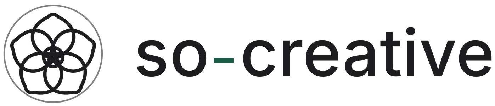

# 見積書（ひな形）

そのまま書き換えて使う。`〔〕` が埋める場所。
金額はサイトの料金シミュレーターと同じ式で出す（食い違うと信用を落とすため）。

---

## 御見積書

**〔株式会社◯◯〕 御中**

|  |  |
|---|---|
| 見積番号 | 〔Q-2026-001〕 |
| 発行日 | 〔2026年◯月◯日〕 |
| 有効期限 | 発行日より30日 |
| 件名 | 〔会社紹介動画 制作一式〕 |

下記のとおりお見積り申し上げます。

### お見積金額　**¥〔444,000〕（税込・総額）**

| 項目 | 内容 | 金額 |
|---|---|---:|
| 企画・構成費 | ヒアリング・企画・進行管理（1案件に1回） | ¥120,000 |
| 追加の本数 | 〔0〕本 × ¥80,000（2本目以降。その本の構成案・絵コンテ・ご確認・書き出し） | ¥〔0〕 |
| 尺 | 〔60〕秒 × ¥〔5,400〕（〔竹 上〕） | ¥〔324,000〕 |
| ナレーション | 〔AI〕（AIは料金に含む／人物は1名 +¥70,000／入れない本は 1本 −¥25,000） | ¥0 |
| **合計（税込）** | | **¥〔444,000〕** |

秒単価は段ごとに1つです（梅 ¥4,000 ／ 竹 ¥5,400 ／ 松 ¥8,000）。

適格請求書発行事業者の登録をしていないため、**消費税を別途申し受けません。
上記がそのまま総額**です（サイトの料金表示と同じ額）。

### 仕様

| | |
|---|---|
| 仕上げの段階 | 〔竹 上〕（登場人物2人まで） |
| 納品形式 | MP4（1920×1080 / 30fps / H.264 / 音声 AAC） |
| 納期 | ご発注から **〔約2週間〕**（構成案・絵コンテのご確認を含む） 目安：30秒 約2週間／90秒 約2週間／3分 約2〜3週間／5分 約3〜4週間 |
| 修正 | **〔3〕往復まで込み**（**再生成を含みます**／梅2回・竹3回・松3回） **ご承認済みの工程への差し戻しは別途**です（下記「追加費用が発生する場合」） |
| 撮影・出演者 | なし（手配費・撮影費は発生しません） |

### 制作の工程とご承認

| | 工程 | 目安 | ご承認 |
|---|---|---|---|
| 01 | ヒアリング（メールでお送りするシートにご記入） | — | — |
| 02 | **構成案**のご確認 | ヒアリングから 2〜4営業日 | **要** |
| 03 | **絵コンテ（各カットの静止画）**のご確認 | 構成案のご承認から 2〜4営業日 | **要** |
| 04 | 制作（映像の生成・編集・テロップ・音） | 3〜8営業日 | お客様の作業はありません |
| 05 | 編集チェック（修正の往復） | 1回につき 1〜3営業日 | — |
| 06 | 納品 | 最終チェックの翌営業日 | — |

- **03 でご承認いただいた静止画が、そのまま映像の元になります。**動かす前に、
  人物の見た目・色味・カメラの寄り引きを、この段階で確定します
- お客様にご対応いただくのは **01・02・03・05 の4回**だけです。いずれもメールで完結します。
  撮影の立ち会いも、ご出演も、現場でのご対応もありません
- **ご承認済みの工程へ戻す変更**（02 の構成、03 の静止画の作り直し）は、
  修正の往復には含みません。都度お見積りいたします

### お支払い条件

- **着手金はいただきません。**制作費は**全額を納品後**にご請求します
- お支払い期日は**納品日から30日以内**です（御社の締め日の都合がある場合はご相談ください）
- お振込手数料は御社にてご負担ください

### 著作権

- 納品物は、**用途・媒体・掲載期間の制限なく**御社にお使いいただけます
- 納品物とその案件のために生成した映像素材を、御社の承諾なく他社に提供したり、他の案件に使用したりしません（納品日から〔2〕年間）
- 納品物の著作権が発生する場合、映画の著作物として御社に帰属する場合（著作権法29条1項）はその帰属を確認し、それ以外の場合は著作権（同法27条・28条の権利を含む）を**お支払い完了をもって御社へ移転**します
- BGM・効果音は、当方で一から合成するか、商用利用と権利の譲渡が認められたプランの音楽生成AIでつくったものを使います。音源サイトなどの素材は使わないため、ほかの納品物と同じく利用の制限はありません
- AI が生成した映像は、人の創作的関与の度合いによっては著作権による保護を受けない場合があります。お使いになるうえで支障はありませんが、第三者が類似の映像を公開した場合に差し止められることまでは保証できません

### 追加費用が発生する場合

| 場合 | 費用 |
|---|---|
| 修正の往復が〔3〕往復を超える場合 | 1往復 ¥〔30,000〕 |
| **ご承認済みの工程への差し戻し**（02 構成案・03 絵コンテの作り直し） | 都度お見積り |
| 縦型・正方形など別の画面比率 | 2本目として ¥80,000＋尺ぶん〜（切り出しではなく設計から作り直すため） |
| 人物ナレーションの追加 | 1名 ¥70,000（何本に入れても1名ぶん。松は1名込み） |

### 着手後のキャンセル

| いつ | ご請求 |
|---|---|
| 絵コンテ（静止画）のご承認まで | 50% |
| 映像の生成に入ったあと | 80% |
| 初稿のご提出後 | 100% |

### 本書のお取り扱い

- 本書および構成案・絵コンテ・企画案は、本件のご検討のためにご提供するものです。
  **弊社の書面による承諾なく、第三者への開示・複製・転載、および本件以外の目的での
  ご使用はご遠慮ください。**ご発注に至らなかった場合も同様とさせていただきます
- 構成案・絵コンテの著作権は、ご発注前の段階では弊社に帰属します。ご発注後の
  納品物の取り扱いは、業務委託契約書 第6条（著作権）のとおりです

### 備考

- 本見積は〔ヒアリング内容〕に基づくものです。尺・本数・仕上げの段階が変わる場合は再見積いたします
- 素材（ロゴ・製品写真・既存の映像など）をご提供いただける場合、別途ご相談ください
- **尺は1本ごとに変えられます**（30秒と90秒を1本ずつ、など）。合計秒数で計算します
- **MV・リリックビデオは料金表の対象外**です。尺・歌詞の有無・画面の向きをうかがって
  個別にお見積りします。楽曲の権利処理（使用許諾・原盤権の確認等）は
  お客様にてお願いします。当方では行いません

---

**so-creative**　鈴木 宏平
愛知県名古屋市／bonvoyage.ti@icloud.com
